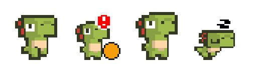

<div align="center">



# pixel-companion

**A pixel dino in your system tray that keeps track of every coding session you have open.**

Works with **Claude Code** and **Codex** &nbsp;·&nbsp; **Windows only**

[](https://python.org)
[](https://github.com/Emi-Dz/pixel-companion)
[](LICENSE)

</div>

---

Pixel Companion lives next to your clock. When you have several Claude or Codex sessions running, Dino shows you the one that needs you most, tells you which session is which, and takes you to the right terminal with one click. It stays out of the way: no windows on top of your work.

---

## Where Dino shows up

### In the system tray

One icon for all your sessions. Dino reflects the most urgent one:

| Dino | Meaning |
|---|---|
| Running | At least one session is working |
| **!** with an orange dot | A session is waiting for your approval (with a soft beep) |
| Standing still | Sessions are ready for your next prompt |
| Sleeping | Nothing has happened for a few minutes |
| Grey | No active sessions |

- **Left-click** — jumps to the terminal of the most urgent session, restoring it if it was minimized.
- **Right-click** — lists every session by name and state, e.g. `campos-29-10 — needs your OK (Edit)`. Click one to bring its terminal to the front.

### In each terminal's status line

Every Claude Code terminal (Windows Terminal or VS Code) can show its own Dino:

```
🦖 campos-29-10 working (Bash) | Opus | my-project | ctx:12%
```

The name is the same one the tray menu uses, so you always know which terminal is which.

---

## Session names

Each session is labeled with the most specific name available:

1. The name you gave the session in Claude Code
2. The name it was launched with (`claude --remote-control <name>`)
3. A `/rename`
4. Claude's automatic session title (the one shown in `/resume`)
5. The project folder, as a last resort

Names refresh on their own, so renaming a session shows up within seconds.

---

## Sessions follow their terminal

Each Dino is tied to the Claude process that owns the session. Close the terminal, kill the process or let it crash, and the session disappears from the tray within a few seconds. Sessions that are closed never pile up.

Codex sessions have no process to follow, so they expire after two hours without activity.

---

## Installation

### Requirements

- Windows 10 or 11
- Python 3.10 or later
- [Claude Code](https://claude.ai/code) and/or [Codex](https://github.com/openai/codex)

### Run

```powershell
git clone https://github.com/Emi-Dz/pixel-companion.git
cd pixel-companion/windows
pip install -r ../requirements.txt
pythonw tray.py
```

On first launch Pixel Companion installs its hooks for Claude Code and Codex. From then on it starts by itself whenever a session sends an event, so you don't need to launch it by hand.

> **Tip:** Windows 11 may place new tray icons in the overflow menu (`^`). Drag Dino next to the clock to keep it visible.

### Status line (optional)

To get Dino in each terminal, point Claude Code's status line to the included script in `~/.claude/settings.json`:

```json
"statusLine": {
  "type": "command",
  "command": "powershell -NoProfile -ExecutionPolicy Bypass -File \"C:\\path\\to\\pixel-companion\\windows\\statusline.ps1\""
}
```

If you already have a status line, copy the segment from `windows/statusline.ps1` into your own script.

### Start with Windows (optional)

Add a shortcut to `windows/Iniciar Mascota.vbs` in your Startup folder (`Win + R` → `shell:startup`).

---

## Settings

Right-click the tray icon to:

- Turn the approval beep on or off
- Remove closed sessions right away
- Quit

The menu language (English / Spanish) is read from `language` in `%USERPROFILE%\.mascota\tray.json`.

---

## How it works

Claude Code and Codex run a small PowerShell hook on every event. The hook:

1. Writes the session's state to `%USERPROFILE%\.mascota\sessions\<session_id>.json`, which the status line reads
2. Sends the event to the tray app on `127.0.0.1:8765`
3. Starts the tray app if it is not running (only one copy ever runs)

**Claude Code events:** `SessionStart` · `UserPromptSubmit` · `PreToolUse` · `PostToolUse` · `PermissionRequest` · `PreCompact` · `Stop` · `SubagentStop` · `SessionEnd`

**Codex events:** `SessionStart` · `UserPromptSubmit` · `PreToolUse` · `PostToolUse` · `PermissionRequest` · `Stop`

---

## Project Structure

```
pixel-companion/
├── windows/
│   ├── tray.py                   Tray app
│   ├── mascota-hook.ps1          Claude Code hook (auto-installed)
│   ├── codex-hook.ps1            Codex hook (auto-installed)
│   ├── statusline.ps1            Status line segment for Claude Code
│   ├── Iniciar Mascota.vbs       Startup shortcut helper
│   ├── assets/sprites/Dino/      Dino sprite sheets (4 states)
│   └── app.py                    Previous floating-window version (no longer launched)
├── assets/                       README images
├── requirements.txt
├── UPSTREAM.md
└── LICENSE
```

---

## Credits

- **[sk-ruban/notchi](https://github.com/sk-ruban/notchi)** — original macOS concept, interaction model, and companion design
- **[AptatoX/notchi-for-windows](https://github.com/AptatoX/notchi-for-windows)** — Windows port that directly inspired this project
- **[Arks](https://arks.itch.io/dino-characters)** — Dino character sprites

See [UPSTREAM.md](UPSTREAM.md) for full attribution notes.

---

## License

GPL-3.0. See [LICENSE](LICENSE).
